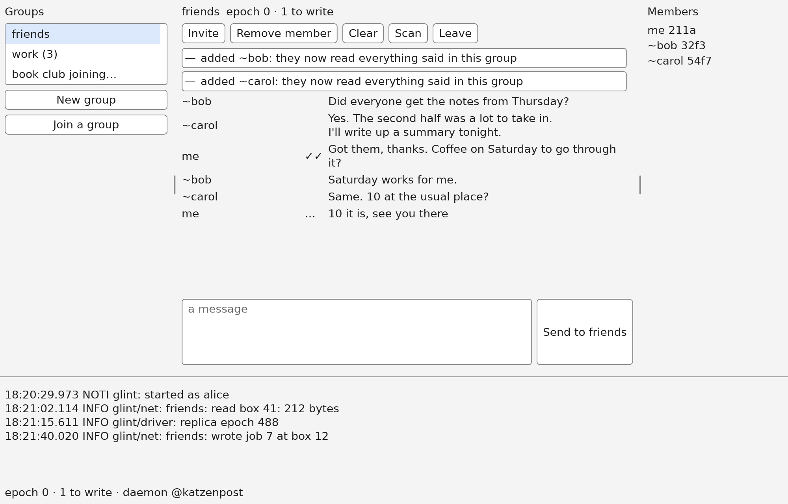

# glint

A desktop group chat over the [Katzenpost](https://katzenpost.network) mixnet, written in Lean,
that speaks [katzenqt](https://github.com/katzenpost/katzenqt)'s group chat: a glint member, a
[jam](https://github.com/katzenpost/jam) member and a katzenqt member can be in one group.

- The group chat protocol is CryptWalker's member state machine
  (`CryptWalker/GroupChat/Member`), with its proofs. glint drives the member as katzenqt's
  adapter does and does the IO.
- Boxes are read and written through the client daemon, `kpclientd`, with the Lean
  [thin client](https://github.com/katzenpost/thin_client).
- The window is drawn with [Paw](https://github.com/katzenpost/paw), on X11 or Wayland, and glint
  logs with [Logger](https://github.com/katzenpost/Logger).

## Building

glint is Lean, with two small Rust libraries underneath it: Paw's, for the window, and one for
the daemon's unix socket. You need:

- **Lean**, through [elan](https://github.com/leanprover/elan), which installs the toolchain
  named in `lean-toolchain` by itself.
- **Rust**, through [rustup](https://rustup.rs). Lake runs `cargo` itself while building, so
  `cargo` only has to be on the `PATH`.
- On Debian or Ubuntu, `libxkbcommon-x11-0` to open a window on X11.
- **git**, and about 8 GB of disk.

Then:

    git clone https://github.com/katzenpost/glint
    cd glint
    make build

`make build` runs `lake exe cache get`, which fetches the dependencies and Mathlib's compiled
files (several GB, which CryptWalker needs), then `lake build glint`. The program is
`.lake/build/bin/glint`.

## Running

glint talks to the mixnet through the Katzenpost client daemon, `kpclientd`. Build it from
[katzenpost](https://github.com/katzenpost/katzenpost) and run it with the client configuration of
the mixnet you want:

    cd katzenpost/cmd/kpclientd && go build && ./kpclientd -c client.toml

Its `[Listen]` section says where glint finds it; `@katzenpost` is the default. Several glint
instances, jam and katzenqt can share one daemon. Then:

    .lake/build/bin/glint --name alice

| Option | |
|---|---|
| `--daemon ADDR` | the daemon's socket: `@katzenpost` (the default), a path, or `HOST:PORT` |
| `--state DIR` | where glint keeps its state and log; by default `$XDG_DATA_HOME/glint/${GLINT_STATE:-default}` |
| `--name NAME` | your display name, which others see; remembered after the first run |
| `--log FILE` | the log file, by default `glint.log` in the state directory |
| `--offline` | show the saved state, without a daemon |

`GLINT_LOG` sets the log level: `critical`, `error`, `warning`, `notice`, `info` (the default) or
`debug`. glint is dark by default; `PAW_THEME=light` gives the light theme, and
`PAW_REDUCE_MOTION=1` turns animations off.

### Starting a group and adding someone

A group is its members: each writes a stream of their own on the mixnet and reads everyone
else's. There are no accounts and no servers.

1. Alice clicks **New group** and names it.
2. Sam clicks **Join a group** and names it as it will be known on his screen. glint mints a
   voucher, and its code appears at the top of the conversation, with a **Copy** button. It is
   also written to `voucher-NAME.txt` in Sam's state directory. Sam gives Alice the code out of
   band.
3. Alice selects the group, clicks **Invite**, and pastes the code. Whoever holds a code reads
   everything said in the group from then on, so she takes it only from the person she means to
   add.
4. A few minutes later Alice sees `— added ~sam`, and Sam `— joined the group`.

Any member can add more people the same way, and everyone hears of them.

## Using it

The groups are on the left, the selected conversation in the middle, and on the right everyone
who reads what is written there, with the start of each member's key. Messages are grouped: one
sender's messages a few minutes apart sit under one header with their name and the time they were
said or read here. The log is hidden until F2 shows it.

| Button | |
|---|---|
| New group | start a group of your own |
| Join a group | join someone else's group: glint shows a voucher code to give one of its members |
| Invite | let the person whose voucher code you were given into the selected group |
| Remove member | stop reading a member and delete what they sent; they can still read the group |
| Clear | delete the selected conversation's lines here |
| Scan | look again for messages a member's stream skipped |
| Leave | stop reading and writing the group and delete it here, once you type its name |
| Attach… | choose a file and send it to the selected group |
| View, Save… | beside a file received: see a picture large, or copy the file out |

The **Send** button names the group the message goes to, and how many lines it is.

### Files

Files travel as katzenqt's do, so glint, jam and katzenqt members can send each other files. A file,
or any message too long for one box, is written to a stream of its own, a box at a time, and the
group's stream then names that stream; members read it before what comes after it. A file can be
up to 16 MB, but each box takes a trip across the mixnet, so a large file takes a long time: its
line says how far it has gone. PNG and JPEG pictures are shown in the conversation, at most
320 × 240, and large with View; other files show their name and size. Received files are kept in
`attachments/` in the state directory, and Save… copies one out.

| Key | |
|---|---|
| Ctrl+Enter | send |
| Ctrl+PageUp, Ctrl+PageDown | the previous or next group |
| F2 | show or hide the log |
| F10 | blank the window at once, and bring it back |
| Ctrl+Q | quit |

Your own messages are marked `…` until written, `✓` once written, and `✓✓` once a member
acknowledges reading them.

## Security

glint follows Paw's [GUI security guidelines](https://github.com/katzenpost/paw/blob/main/docs/GUI_SECURITY_GUIDELINES.md):
everything another member sends is untrusted.

- **One filter.** Text from elsewhere reaches a widget only as Paw's `SafeText` or `SafeName`,
  through `Glint.Display`. Control characters, invisible characters, private-use glyphs and line
  separators show as `�`; combining marks are capped at four a letter; a message shows at most 20
  lines and says how many more there were. Nothing is parsed as markup.
- **glint decides who said what.** A member's chosen name is shown after `~`, ours as `me`. A
  name cannot hold bidi controls, joiners, badges, or glint's own marks (`…`, `✓`), and is cut at
  30 characters. Names that look alike, names like ours and names mixing scripts show the start of
  the member's key, and are marked `(!)` among the members.
- **A message cannot pass for another.** A run of messages begins with a header glint draws: the
  sender's name in bold, flush left, and the time. Every row of a message is indented under it,
  in regular weight, with our delivery mark in a column of its own, so no row of a message can
  look like a header. glint's own notices are small, muted and centered, which no message is.
- **Authority follows the user's click.** The message box only sends text; everything else is a
  button. A dialog opens only from the user's click, never from the network, and its accept
  button takes no click in the half second after it appears. A member to remove is chosen from
  the list, by key. Copy writes the clipboard only for a click on it. A file is read only once
  you choose it and click Send, and one received is written outside the state directory only where
  you save it, never over a file already there. glint asks for the
  clipboard and for running tasks, and for nothing else: no links, no notifications. The window's
  title is always "glint".
- **Pictures.** A picture received is decoded by Paw, which takes only PNG and JPEG and refuses one
  larger than 8192 pixels a side or 64 MiB of pixels before decoding it. A file's name is cut to
  ASCII letters, digits and `._-+()[]` and spaces before it is shown or kept.
- **On disk.** The state directory is created 0700, `state.cbor`, `glint.log` and received files
  0600. The log is
  filtered like the screen and holds no message text. `state.cbor` and `attachments/` are not encrypted:
  they hold your write caps and every message and file. Clear deletes a conversation's lines and
  files, Leave the group.
- **Leaving.** F10 blanks the window at once. SIGTERM, SIGHUP and SIGQUIT exit.

## Testing

    make test          # in one process: what reaches the screen, each action, the window
                       # driven by clicks and keys, and two members each with a shell and a window
    make e2e           # a saved state in a real window on Xvfb, driven with xdotool
    make shots         # pictures of the window, drawn offscreen, in shots/
    make screenshot    # docs/screenshot.png, from a conversation over the simulated Pigeonhole
    N=5 DAEMON=@katzenpost sh tests/e2e/mixnet.sh   # N windows (2 to 8) in one group, against a running kpclientd
    ./test-integration.sh                       # the same over the docker mixnet

The client core, its saved state and its scenarios are tested in
[group_chat_client](https://github.com/katzenpost/group_chat_client), which glint shares with jam.
